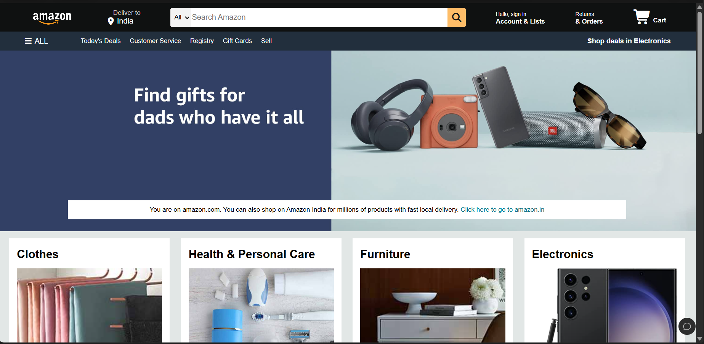

# Amazon Homepage Clone

A static storefront homepage recreation built with HTML and CSS as a front-end practice project.

## Preview

[View the live demo](https://mohammedsaad-work.github.io/Amazon/)

## Project overview

This page recreates the visual structure of an e-commerce storefront, including a header, navigation, search area, promotional hero, category cards, and footer. It uses local image assets and CSS for layout and styling.

## Run locally

1. Clone this repository.
2. Open `index.html` in a browser.
3. Keep `style.css` and the image assets beside `index.html`.

The Font Awesome icons load from a CDN, so an internet connection is needed for those icons.

## Technologies

- HTML
- CSS
- Font Awesome (CDN)

## Scope

This is an unofficial learning exercise and is not affiliated with Amazon. It is a static visual demo: the search, account, cart, shopping, and navigation controls do not perform real actions.
